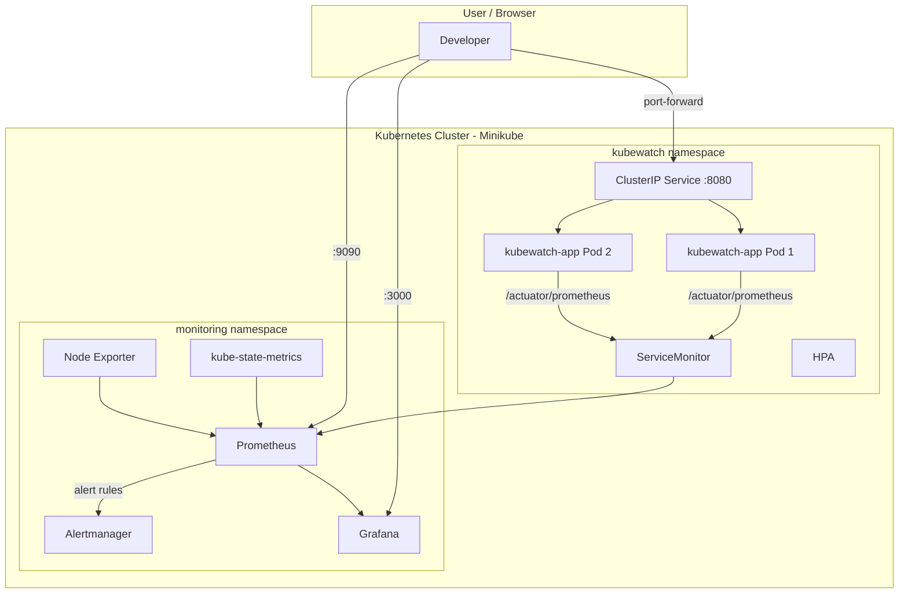

# KubeWatch: Kubernetes Monitoring and Alerting Platform

> **Course:** INT334 – Enterprise Application Automation  
> **Tech Stack:** Spring Boot 3.2 · Docker · Kubernetes · Prometheus · Grafana · Alertmanager · Helm

---

## 1. Project Overview

KubeWatch is a monitoring platform that deploys a Spring Boot application on Kubernetes and monitors its health, performance, and resource utilization using Prometheus and Grafana.

### Key Features
- Spring Boot REST API with Actuator and Micrometer metrics
- Docker containerization with multi-stage builds
- Kubernetes deployment with auto-scaling, probes, and rolling updates
- Prometheus metrics collection via ServiceMonitor
- Grafana dashboards for application and infrastructure metrics
- Alertmanager alert rules for failures, errors, and resource utilization
- Helm-based monitoring stack installation
- Automated setup and verification scripts

---

## 2. Architecture



### Data Flow

| Flow | Path |
|------|------|
| **Application Metrics** | Spring Boot → Actuator/Micrometer → `/actuator/prometheus` → ServiceMonitor → Prometheus → Grafana |
| **K8s Infrastructure** | kube-state-metrics + Node Exporter → Prometheus → Grafana |
| **Alerting** | Prometheus Rules → Alertmanager → Webhook/Notification |
| **Auto-scaling** | Metrics Server → HPA → Scale Deployment |

---

## 3. Technology Stack

| Component | Version | Purpose |
|-----------|---------|---------|
| Java | 21 | Runtime |
| Spring Boot | 3.2.5 | Application framework |
| Spring Boot Actuator | 3.2.5 | Health and metrics endpoints |
| Micrometer | 1.12.x | Prometheus metrics bridge |
| Maven | 3.9.x | Build tool |
| Docker | Latest | Containerization |
| Kubernetes | 1.28+ | Orchestration |
| Minikube | Latest | Local K8s cluster |
| Prometheus | via Helm | Metrics collection |
| Grafana | via Helm | Dashboard visualization |
| Alertmanager | via Helm | Alert routing |
| Helm | 3.x | Package manager |

---

## 4. Prerequisites (Windows 11)

Install the following before starting:

1. **Java 21** – [Download](https://www.oracle.com/java/technologies/downloads/#java21)
2. **Maven 3.9+** – [Download](https://maven.apache.org/download.cgi)
3. **Docker Desktop** – [Download](https://www.docker.com/products/docker-desktop/)
4. **Minikube** – [Download](https://minikube.sigs.k8s.io/docs/start/)
5. **kubectl** – [Download](https://kubernetes.io/docs/tasks/tools/install-kubectl-windows/)
6. **Helm 3** – [Download](https://helm.sh/docs/intro/install/)

Verify installations:
```powershell
java -version
mvn -version
docker --version
minikube version
kubectl version --client
helm version
```

---

## 5. Quick Start

### Option A: Automated Setup
```powershell
.\scripts\setup.bat
```

### Option B: Step-by-Step Manual Setup

#### 5.1 Start Minikube
```powershell
minikube start --driver=docker --cpus=4 --memory=8192 --kubernetes-version=v1.28.0
minikube addons enable metrics-server
```

#### 5.2 Build the Application
```powershell
cd app
mvn clean package -B
```

#### 5.3 Build Docker Image (inside Minikube)
```powershell
# Point Docker CLI to Minikube's Docker daemon
minikube docker-env --shell powershell | Invoke-Expression

# Build the image
docker build -t kubewatch-app:1.0.0 ./app
```

> **Docker Desktop Kubernetes users:** If using Docker Desktop's built-in Kubernetes instead of Minikube, the image built by `docker build` is already available to Kubernetes. Skip the `minikube docker-env` step.

#### 5.4 Deploy to Kubernetes
```powershell
kubectl apply -f k8s/namespace.yaml
kubectl apply -f k8s/configmap.yaml
kubectl apply -f k8s/deployment.yaml
kubectl apply -f k8s/service.yaml
kubectl apply -f k8s/hpa.yaml
```

#### 5.5 Verify Deployment
```powershell
kubectl get pods -n kubewatch
kubectl get svc -n kubewatch
kubectl wait --for=condition=ready pod -l app=kubewatch-app -n kubewatch --timeout=120s
```

#### 5.6 Access the Application
```powershell
kubectl port-forward svc/kubewatch-app 8080:8080 -n kubewatch
```
- Welcome: http://localhost:8080
- Health: http://localhost:8080/api/health
- Metrics Demo: http://localhost:8080/api/metrics-demo
- Error Demo: http://localhost:8080/api/error-demo
- Actuator Health: http://localhost:8080/actuator/health
- Prometheus Metrics: http://localhost:8080/actuator/prometheus

---

## 6. Helm Monitoring Stack Installation

### 6.1 Add Helm Repository
```powershell
helm repo add prometheus-community https://prometheus-community.github.io/helm-charts
helm repo update
```

### 6.2 Install kube-prometheus-stack
```powershell
helm upgrade --install monitoring prometheus-community/kube-prometheus-stack `
  --namespace monitoring --create-namespace `
  -f monitoring/values.yaml `
  --wait --timeout 10m
```

### 6.3 Apply ServiceMonitor and Alert Rules
```powershell
kubectl apply -f monitoring/servicemonitor.yaml
kubectl apply -f monitoring/prometheus-rules.yaml
```

### 6.4 Verify Installation
```powershell
kubectl get pods -n monitoring
helm list -n monitoring
kubectl get servicemonitors -n kubewatch
kubectl get prometheusrules -n kubewatch
```

### 6.5 Upgrade Monitoring Stack
```powershell
helm upgrade monitoring prometheus-community/kube-prometheus-stack `
  --namespace monitoring -f monitoring/values.yaml
```

### 6.6 Uninstall
```powershell
helm uninstall monitoring -n monitoring
```

---

## 7. Accessing Services (Port Forwarding)

Run all port-forwards at once:
```powershell
.\scripts\port-forward.bat
```

Or individually:

| Service | Command | URL |
|---------|---------|-----|
| **Application** | `kubectl port-forward svc/kubewatch-app 8080:8080 -n kubewatch` | http://localhost:8080 |
| **Prometheus** | `kubectl port-forward svc/monitoring-kube-prometheus-prometheus 9090:9090 -n monitoring` | http://localhost:9090 |
| **Grafana** | `kubectl port-forward svc/monitoring-grafana 3000:80 -n monitoring` | http://localhost:3000 |
| **Alertmanager** | `kubectl port-forward svc/monitoring-kube-prometheus-alertmanager 9093:9093 -n monitoring` | http://localhost:9093 |

**Grafana Credentials:** `admin` / `kubewatch-admin`

---

## 8. Prometheus Scrape Verification

1. Open Prometheus: http://localhost:9090
2. Go to **Status → Targets**
3. Look for the `kubewatch-app` target
4. Status should show **UP**

If the target doesn't appear:
```powershell
# Check ServiceMonitor exists
kubectl get servicemonitors -n kubewatch

# Describe the ServiceMonitor
kubectl describe servicemonitor kubewatch-app-monitor -n kubewatch

# Check Prometheus config has the scrape target
kubectl logs -l app.kubernetes.io/name=prometheus -n monitoring | Select-String "kubewatch"
```

### Sample PromQL Queries
```promql
# Application up/down
up{job="kubewatch-app"}

# HTTP request rate
sum(rate(http_server_requests_seconds_count{application="kubewatch-app"}[5m])) by (uri)

# HTTP 5xx error rate
sum(rate(http_server_requests_seconds_count{application="kubewatch-app", status=~"5.."}[5m]))

# Response latency p95
histogram_quantile(0.95, sum(rate(http_server_requests_seconds_bucket{application="kubewatch-app"}[5m])) by (le, uri))

# JVM heap memory
jvm_memory_used_bytes{application="kubewatch-app", area="heap"}

# Pod CPU usage
sum(rate(container_cpu_usage_seconds_total{namespace="kubewatch", container="kubewatch-app"}[5m])) by (pod)

# Pod memory usage
container_memory_working_set_bytes{namespace="kubewatch", container="kubewatch-app"}

# Custom error counter
kubewatch_errors_total{application="kubewatch-app"}
```

---

## 9. Grafana Dashboard Setup

### 9.1 Auto-Provisioned Dashboards
The kube-prometheus-stack Helm chart automatically provisions Kubernetes and Prometheus dashboards.

### 9.2 Import KubeWatch Dashboard
1. Open Grafana: http://localhost:3000
2. Go to **Dashboards → Import**
3. Upload `monitoring/grafana-dashboards/kubewatch-dashboard.json`
4. Select **Prometheus** as the data source
5. Click **Import**

### Dashboard Panels
| Panel | Metric |
|-------|--------|
| Application Status | `up{job="kubewatch-app"}` |
| Running Pods | `kube_pod_status_ready{namespace="kubewatch"}` |
| Pod Restarts | `kube_pod_container_status_restarts_total{namespace="kubewatch"}` |
| Error Rate | 5xx / total request ratio |
| HTTP Request Rate | `http_server_requests_seconds_count` by URI |
| Response Latency (p95) | Histogram quantile |
| HTTP 4xx/5xx Responses | Error status codes |
| JVM Heap Memory | Used, max, committed |
| JVM Non-Heap Memory | Used, committed |
| Pod CPU Usage | `container_cpu_usage_seconds_total` |
| Pod Memory Usage | `container_memory_working_set_bytes` |

---

## 10. Alert Configuration and Testing

### 10.1 Configured Alert Rules

| Alert | Condition | Severity |
|-------|-----------|----------|
| KubeWatchAppDown | `up{job="kubewatch-app"} == 0` for 1m | Critical |
| KubeWatchAppHighErrorRate | >10% 5xx responses for 2m | Warning |
| KubeWatchHighCPU | >80% CPU limit for 5m | Warning |
| KubeWatchHighMemory | >85% memory limit for 5m | Warning |
| KubeWatchPodRestarting | >3 restarts in 1h | Critical |
| KubeWatchPodNotReady | Not ready for 5m | Warning |
| KubeWatchJVMHeapHigh | >90% heap for 5m | Warning |

### 10.2 Testing Alerts

**Trigger High Error Rate:**
```powershell
# Generate error traffic
for ($i=0; $i -lt 50; $i++) { Invoke-WebRequest -Uri http://localhost:8080/api/error-demo -Method GET -ErrorAction SilentlyContinue }
```

**Trigger App Down Alert:**
```powershell
# Scale deployment to 0
kubectl scale deployment kubewatch-app --replicas=0 -n kubewatch

# Wait 1-2 minutes, then check Alertmanager
# Restore:
kubectl scale deployment kubewatch-app --replicas=2 -n kubewatch
```

**Trigger Pod Restart Alert:**
```powershell
# Delete a pod
kubectl delete pod -l app=kubewatch-app -n kubewatch --wait=false
```

### 10.3 Viewing Alerts
- **Prometheus Alerts:** http://localhost:9090/alerts
- **Alertmanager:** http://localhost:9093/#/alerts

---

## 11. Kubernetes Demonstrations

### 11.1 Check Pod and Service Status
```powershell
kubectl get pods -n kubewatch -o wide
kubectl get svc -n kubewatch
kubectl get deployments -n kubewatch
kubectl describe deployment kubewatch-app -n kubewatch
```

### 11.2 Scaling Replicas
```powershell
# Scale up
kubectl scale deployment kubewatch-app --replicas=3 -n kubewatch
kubectl get pods -n kubewatch -w

# Scale down
kubectl scale deployment kubewatch-app --replicas=2 -n kubewatch
```

### 11.3 Rolling Update
```powershell
# Update the image (simulate new version)
kubectl set image deployment/kubewatch-app kubewatch-app=kubewatch-app:1.0.1 -n kubewatch

# Watch the rollout
kubectl rollout status deployment/kubewatch-app -n kubewatch

# View rollout history
kubectl rollout history deployment/kubewatch-app -n kubewatch

# Rollback if needed
kubectl rollout undo deployment/kubewatch-app -n kubewatch
```

### 11.4 Pod Recovery
```powershell
# Delete a pod and watch recovery
kubectl delete pod -l app=kubewatch-app -n kubewatch --wait=false
kubectl get pods -n kubewatch -w
```

### 11.5 View Logs
```powershell
# View logs for all pods
kubectl logs -l app=kubewatch-app -n kubewatch --tail=50

# Follow logs
kubectl logs -f deployment/kubewatch-app -n kubewatch

# View events
kubectl get events -n kubewatch --sort-by=.metadata.creationTimestamp
```

---

## 12. Helm Application Chart (Optional)

Deploy the application using the custom Helm chart:
```powershell
# Install
helm install kubewatch-app ./helm/kubewatch-app -n kubewatch --create-namespace

# Upgrade
helm upgrade kubewatch-app ./helm/kubewatch-app -n kubewatch

# List releases
helm list -n kubewatch

# Uninstall
helm uninstall kubewatch-app -n kubewatch
```

---

## 13. Troubleshooting

| Issue | Solution |
|-------|----------|
| **Image pull error** | Run `minikube docker-env --shell powershell \| Invoke-Expression` then rebuild |
| **Pods in CrashLoopBackOff** | Check logs: `kubectl logs <pod-name> -n kubewatch` |
| **ServiceMonitor not detected** | Verify labels match: `release: monitoring` |
| **Prometheus target missing** | Check `serviceMonitorSelectorNilUsesHelmValues: false` in values.yaml |
| **Grafana login fails** | Default: `admin` / `kubewatch-admin` |
| **HPA shows unknown** | Enable metrics-server: `minikube addons enable metrics-server` |
| **Port-forward disconnects** | Re-run the port-forward command |
| **Minikube out of memory** | Increase: `minikube start --memory=8192` |

---

## 14. Cleanup

```powershell
.\scripts\cleanup.bat
```

Or manually:
```powershell
helm uninstall monitoring -n monitoring
kubectl delete -f monitoring/prometheus-rules.yaml
kubectl delete -f monitoring/servicemonitor.yaml
kubectl delete -f k8s/ --recursive
kubectl delete namespace kubewatch
kubectl delete namespace monitoring
minikube stop
```

---

## 15. Project Structure

```
kubewatch/
├── app/                              # Spring Boot application
│   ├── src/main/java/com/kubewatch/
│   │   ├── KubeWatchApplication.java     # Main entry point
│   │   ├── config/
│   │   │   └── MetricsConfig.java        # Micrometer config
│   │   └── controller/
│   │       └── HomeController.java       # REST endpoints
│   ├── src/main/resources/
│   │   └── application.yaml             # Spring config
│   ├── src/test/java/com/kubewatch/
│   │   ├── KubeWatchApplicationTest.java
│   │   └── controller/
│   │       └── HomeControllerTest.java   # Integration tests
│   ├── Dockerfile                        # Multi-stage Docker build
│   ├── .dockerignore
│   └── pom.xml                           # Maven config
├── k8s/                              # Kubernetes manifests
│   ├── namespace.yaml
│   ├── deployment.yaml
│   ├── service.yaml
│   ├── configmap.yaml
│   └── hpa.yaml
├── monitoring/                       # Monitoring configuration
│   ├── values.yaml                       # Helm values for kube-prometheus-stack
│   ├── servicemonitor.yaml               # Prometheus scrape config
│   ├── prometheus-rules.yaml             # Alert rules
│   ├── grafana-dashboard-configmap.yaml
│   └── grafana-dashboards/
│       └── kubewatch-dashboard.json      # Grafana dashboard
├── helm/                             # Custom Helm chart
│   └── kubewatch-app/
│       ├── Chart.yaml
│       ├── values.yaml
│       └── templates/
│           ├── namespace.yaml
│           ├── deployment.yaml
│           ├── service.yaml
│           ├── servicemonitor.yaml
│           └── hpa.yaml
├── scripts/                          # Automation scripts
│   ├── setup.bat
│   ├── verify.bat
│   ├── cleanup.bat
│   ├── port-forward.bat
│   └── generate-traffic.bat
├── docs/
│   └── architecture.md
├── .env.example
├── .gitignore
└── README.md
```

---

## 16. Viva Preparation – Architecture Explanation

**Short explanation for your college viva:**

> KubeWatch demonstrates enterprise application monitoring using a Spring Boot application deployed on Kubernetes.
>
> The application exposes REST endpoints and uses **Spring Boot Actuator** with **Micrometer** to expose application metrics in Prometheus format at `/actuator/prometheus`. These metrics include HTTP request counts, response latencies, error rates, and JVM memory usage.
>
> The application is containerized using **Docker** with a multi-stage build and deployed to **Kubernetes** with two replicas, health probes (startup, readiness, liveness), and a Horizontal Pod Autoscaler.
>
> **Prometheus** (installed via the `kube-prometheus-stack` Helm chart) scrapes these metrics using a **ServiceMonitor** CRD. It also collects Kubernetes infrastructure metrics through **kube-state-metrics** and **Node Exporter**.
>
> **Grafana** connects to Prometheus as a data source and displays dashboards showing application health, HTTP request rates, error rates, response latencies, JVM memory, and pod CPU/memory usage.
>
> **Alertmanager** receives alerts from Prometheus based on defined rules — for example, when the application is down, when the error rate exceeds 10%, or when a pod restarts too frequently.
>
> This setup demonstrates key enterprise automation concepts: containerization, orchestration, monitoring, alerting, auto-scaling, and rolling deployments — all running locally on Windows 11 using Minikube.

---

## 17. Expected Evidence for Practical Demonstration

During your demo, show:
1. ✅ Application running in Kubernetes (`kubectl get pods`)
2. ✅ REST endpoints responding (hit each URL)
3. ✅ Prometheus targets showing UP
4. ✅ Grafana dashboard with live metrics
5. ✅ Generate traffic and see metrics update in Grafana
6. ✅ Trigger error-demo and see error rate spike
7. ✅ Delete a pod and show auto-recovery
8. ✅ Scale replicas and observe behavior
9. ✅ Show alert rules in Prometheus
10. ✅ Show fired alert in Alertmanager

---

## License

This project is for educational purposes – INT334 Enterprise Application Automation.
