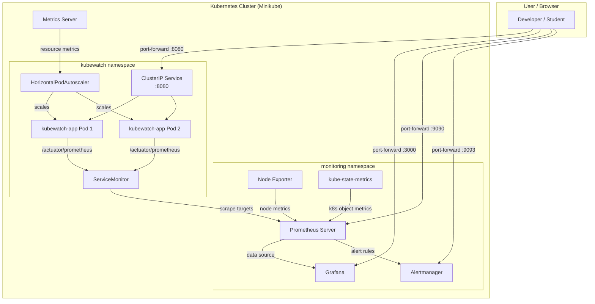

# KubeWatch Architecture and Demonstration Guide

## System Architecture

### Architecture Diagram

### Data Flow

1. **Application Metrics Flow:**
   - Spring Boot Actuator exposes metrics via Micrometer at `/actuator/prometheus`
   - ServiceMonitor tells Prometheus where to scrape
   - Prometheus scrapes metrics every 15 seconds
   - Grafana queries Prometheus and displays dashboards

2. **Kubernetes Metrics Flow:**
   - kube-state-metrics exports Kubernetes object states (pod status, replicas, restarts)
   - Node Exporter exports host-level metrics (CPU, memory, disk)
   - Metrics Server provides resource metrics for HPA

3. **Alerting Flow:**
   - Prometheus evaluates PrometheusRule alert expressions
   - When conditions are met, alerts fire to Alertmanager
   - Alertmanager groups, routes, and sends notifications

## Key Components

| Component | Purpose | Namespace |
|-----------|---------|-----------|
| kubewatch-app | Spring Boot REST API with Actuator metrics | kubewatch |
| Prometheus | Metrics collection and storage | monitoring |
| Grafana | Dashboard visualization | monitoring |
| Alertmanager | Alert routing and notification | monitoring |
| ServiceMonitor | Auto-discovery of scrape targets | kubewatch |
| HPA | Auto-scaling based on resource usage | kubewatch |
| kube-state-metrics | Kubernetes object metrics | monitoring |
| Node Exporter | Node-level metrics | monitoring |

## Demonstration Scenarios

### Scenario 1: Application Health Monitoring
Show that Grafana displays real-time application health, request rates, and JVM metrics.

### Scenario 2: Error Rate Alert
Hit `/api/error-demo` repeatedly to trigger the high error rate alert.

### Scenario 3: Pod Recovery
Delete a pod and show Kubernetes recreates it automatically.

### Scenario 4: Scaling
Scale replicas up/down and observe HPA behavior.

### Scenario 5: Rolling Update
Update the image tag and demonstrate zero-downtime deployment.
